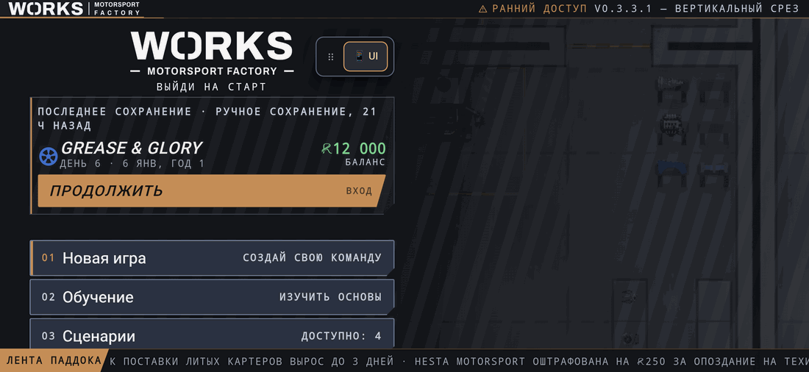
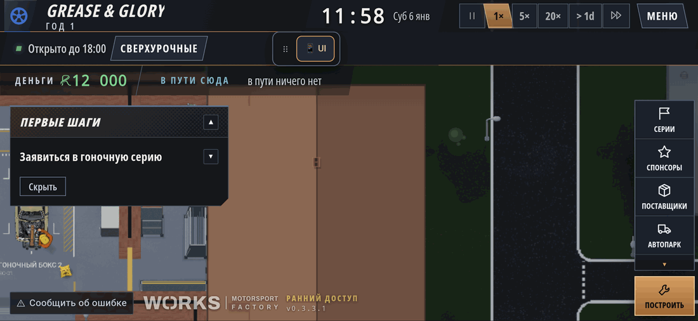
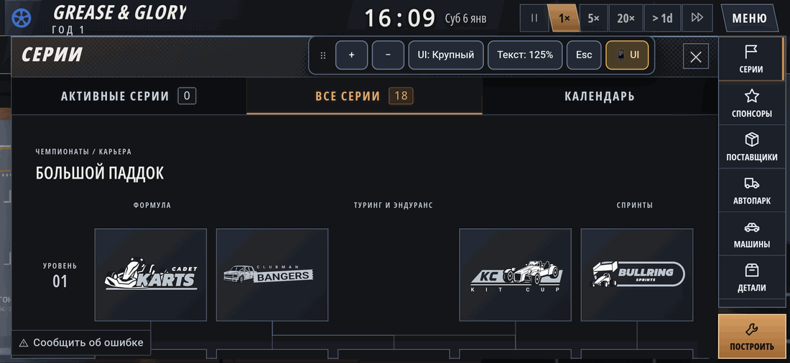

# WORKS: Motorsport Factory (Android APK)

Неофициальная сборка игры **WORKS: Motorsport Factory** (ранний доступ `v0.3.3.1`) для Android с русским интерфейсом и встроенной адаптацией под сенсорный экран.

  

| Завод и игровой процесс | Раздел «Серии» и панель управления UI |
| :---: | :---: |
|  |  |

## Установка

1. Скачайте `WORKS-Motorsport-Factory.apk` по кнопке выше или со страницы [Releases](https://github.com/DomenicoCano/WORKS-Motorsport-Factory-APK/releases/latest) (~613 МБ).
2. Откройте скачанный файл на устройстве с Android 10 и выше (`minSdk 29`).
3. При запросе разрешите установку из неизвестных источников (для браузера или файлового менеджера).
4. Запустите **WORKS: Motorsport Factory**. При необходимости нажмите на плавающую кнопку `UI`, чтобы подобрать удобный масштаб интерфейса и размер текста.

Для удаления достаточно удалить приложение **WORKS: Motorsport Factory** стандартным способом в настройках Android.

## Что умеет

- Русский интерфейс игры (`v0.3.3.1`, ранний доступ).
- Сенсорное управление камерой: панорамирование и масштабирование двумя пальцами (pinch-to-zoom).
- Плавающая панель `UI` (перетаскивается по экрану): быстрые кнопки масштаба (`+` / `−`), выбор размера интерфейса (`Огромный`, `Крупный`, `Средний`, `Мелкий`), размер текста (`100%`, `125%`, `150%`) и кнопка `Esc`.
- Контекстные кнопки для режимов стройки, редактора трассы и пит-стопов (переключение камеры/действия, поворот, отражение, серийное размещение).
- Интеграция системной кнопки «Назад» (закрывает режим стройки, диалоги и боковые панели) и приостановка звука при сворачивании приложения.

## Что проверено

- Метаданные APK (`aapt2 dump badging`): пакет `com.riverrock.works`, `versionCode 2`, `versionName 0.3.3.1`, `minSdk 29` (Android 10+), `targetSdk 35` (Android 15), альбомная ориентация.
- Цифровая подпись (`apksigner verify --print-certs`): `CN=WORKS Motorsport Factory, OU=Android, O=WORKS Contributors, C=XX`, SHA-256 сертификата `802b593d11f963c14002f82c59b27183825de703622d493bb56df4459b53510e`.
- Работа установленной сборки на реальном смартфоне (Android 16, экран 2756×1268): запуск главного меню, загрузка сохранения и отображение завода, переход в раздел «Серии», раскрытие панели `UI`.
- Проверка на утечки приватных данных (`scan_privacy.py`) по всему APK и файлам репозитория: утечек не обнаружено.

## Известные ограничения

- Воспроизведение звука вживую при проверке не оценивалось.
- Работа на других моделях устройств и версиях Android 10–15 отдельно не тестировалась.
- APK подписан самостоятельным ключом — Google Play Protect может показать предупреждение при установке.
- При первом открытии режима стройки всплывающая подсказка может частично перекрываться с раскрытой панелью `UI` (панель можно перетащить за маркер слева).
- О найденных проблемах можно сообщить в [Issues](https://github.com/DomenicoCano/WORKS-Motorsport-Factory-APK/issues).

## Контрольная сумма

| Файл | Размер | SHA-256 |
| :--- | :--- | :--- |
| `WORKS-Motorsport-Factory.apk` | 643 194 823 байт (~613 МБ) | `A0DA334D195B7538219A681D66BBFB89B44081E386CCDDC757F5C22D99EAA57E` |

## Состав репозитория

Бинарный файл `.apk` не хранится в git-дереве — он прикреплён к [GitHub Releases](https://github.com/DomenicoCano/WORKS-Motorsport-Factory-APK/releases).

| Путь | Назначение |
| :--- | :--- |
| `README.md` | Описание, инструкция по установке, контрольная сумма |
| `docs/screenshot-menu.png` | Скриншот главного меню на Android |
| `docs/screenshot-factory.png` | Скриншот игрового процесса (завод) |
| `docs/screenshot-series.png` | Скриншот раздела «Серии» с раскрытой панелью `UI` |
| `.gitignore` | Исключение локальных бинарных файлов и ключей подписи |

## Важно

Репозиторий содержит неофициальную Android-сборку и не связан с разработчиками оригинальной игры **WORKS: Motorsport Factory** (River Rock).
